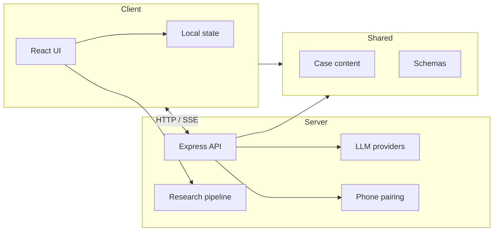

# BIZSIM

**Open-source business case simulation and strategic decision-making.**
Play real business history as **seasons of four episodes, each made of two or more linked decisions with its own outcome and insight**, from Hammurabi’s Babylon to OpenAI’s boardroom, and see what actually happened, with cited sources. Research any live company from public sources and turn the evidence into a playable season whose last episode is happening now, or describe the season you want in plain language and let the chat builder write it.


*Workspace overview with daily featured case, quick research bar, and recent activity.*

No accounts. No tracking. Your progress stays on your devices.

Windows · macOS · Linux · Android · iPhone/iPad · Web

### Highlights

- **15 interface languages plus English (UK)**: English (US), English (UK), বাংলা, Español, Português (Brasil), Français, العربية, हिन्दी, 简体中文, 日本語, Deutsch, Русский, Bahasa Indonesia, Türkçe, 한국어, اردو. Choose in Settings → Language; switching is instant and never touches your progress. Right-to-left layout for Arabic and Urdu.
- AI-written seasons (live research, chat builder) are written in your language.
- All translations are **machine-assisted and not yet reviewed** by native speakers. Built-in seasons are English, apart from a one-season sample in Bengali and Spanish. See [docs/I18N.md](docs/I18N.md).
- **Share a season or a single episode** as a `.bizsim` file or QR codes, including seasons from live research and the chat builder. Imports are checked, previewed and never overwrite anything without asking. See [docs/PACKAGE-FORMAT.md](docs/PACKAGE-FORMAT.md).
- **Notifications, off until you turn them on**: Case of the Day, resume reminders, a weekly goal, season and research completion, your own reminders. Quiet hours, per-category switches, an inbox. Scheduled on the device, no account.
- **Case of the Day**, **collections and bookmarks**, **replay and compare** attempts, a **PDF report** with your reflection.
- **Trust labels**: every season shows whether it is documented history, a scriptural narrative, a live scenario or a counterfactual, whether AI wrote it, and the evidence status of each outcome.
- **Security hardening**: Wi-Fi pairing (one-time codes, signed requests, replay protection), encrypted AI keys over Wi-Fi, validated imports and backups. See [docs/SECURITY.md](docs/SECURITY.md).

Release notes: [docs/RELEASE-NOTES-1.7.md](docs/RELEASE-NOTES-1.7.md) · [docs/RELEASE-NOTES-1.6.md](docs/RELEASE-NOTES-1.6.md).

## What you get

| Area | What it does |
|---|---|
| **200 offline seasons** | **800 episodes · 1,600 decisions** across 6 executive pillars (Strategy, Finance, Brand, Operations, Turnarounds, Leadership) — spanning ancient statesmen, historic merchant networks, and modern operators, plus 10 hand-written signature seasons. Plays fully offline with no AI key. See [docs/CATALOGUE.md](docs/CATALOGUE.md). |
| **6-step method** | **Situation → Concept → Evidence → Episodes → Outcome → Insight.** Spoiler-free decisions compared against history, with cited outcomes and takeaways after each episode. |
| **Principles library** | 76 paraphrased principles from 30 classic strategy and business books. Add your own books, principles, and custom tags to link and filter seasons. |
| **Live research & Chat builder** | **Research a company** from Wikidata, Wikipedia, SEC EDGAR, news, and official sites to generate a 4-episode season (with Episode IV set in the present). Or use **Chat builder** to describe any custom case in plain language. |
| **AI key fallback chain** | Add keys from Gemini, NVIDIA NIM, Groq, Anthropic, OpenAI, OpenRouter, xAI, or local Ollama. Automatically tests models, repairs broken JSON, and falls back on rate limits or errors. |
| **Voice reader** | Built-in offline neural TTS (**Listen** button) powered by Piper. |
| **Cross-device** | Desktop, web, Android, iOS. Progress backup/restore and QR transfer. Phone access over Wi‑Fi with modern pairing. |
| **Privacy-first** | No accounts, no tracking, no cloud of yours. Keys and progress stay on your devices. See [docs/SECURITY.md](docs/SECURITY.md). |

## Download

**[Download the latest release →](https://github.com/kmmohaimenulhaque-code/BIZSIM.tm/releases)**

Open the newest release and pick the asset for your platform from **Assets** (Windows Setup, macOS zip/dmg/pkg, Linux AppImage or tar.gz, Android APK, iOS ipa, plus `SHA256SUMS.txt`).

| Platform | Notes |
|---|---|
| **Windows 10/11** | Setup `.exe` in Assets. Unsigned: on the blue SmartScreen box click *More info → Run anyway*. Choose *just for me / all users* and the install folder. Allow the firewall prompt only if you want phone access. |
| **macOS (Apple Silicon)** | `.zip` / `.dmg` / `.pkg` in Assets. Put `BIZSIM.app` anywhere (Applications is usual). First launch: right-click → *Open* → *Open*. If macOS says it is damaged: `xattr -cr /path/to/BIZSIM.app`. |
| **macOS (Intel)** | Same steps; use the Intel (`x64`) builds from Assets. |
| **Linux** | AppImage: `chmod +x` then run. Or extract the `.tar.gz` and run `./bizsim`. |
| **Android 6+** | `.apk` in Assets. Allow *Install unknown apps* for your browser/files app. Installs over earlier versions and keeps progress. |
| **iPhone / iPad** | Unsigned `.ipa` in Assets (Sideloadly/AltStore), or build with Xcode from `ios/` on a Mac. **Instant option:** open BIZSIM in Safari → Share → *Add to Home Screen*. |

## Setup instructions (desktop env file)

Optional local config for desktop/server (API keys, SEC User-Agent). Prefer **Settings → AI keys** in the app when possible.

```bash
mkdir -p ~/.config/bizsim
cat > ~/.config/bizsim/bizsim.env <<'EOF'
GEMINI_API_KEY=paste-your-key-here
SEC_USER_AGENT=Your Name your@email.com
EOF
```

Also see `.env.example` in the repo root for the full list of variables (CORS, TRUST_PROXY, server-side keys for public web, etc.).

## Run from source

```bash
npm install
npm run dev          # API + Vite client
npm start            # production server after npm run build
npm test
npm run dist:win          # Windows installer (on Windows, or Linux with Wine)
npm run dist:mac          # macOS dmg + pkg + zip (on a Mac; see build/entitlements.mac.plist)
npm run dist:linux
npm run mobile:android
npm run mobile:ios
npx cap open ios                             # macOS + Xcode
```

**GitHub Actions** (`.github/workflows/build.yml`) builds Windows, macOS, Linux, Android and an unsigned iOS `.ipa` on free runners. Push a version tag or run the workflow manually, then download from the run’s *Artifacts* or from [Releases](https://github.com/kmmohaimenulhaque-code/BIZSIM.tm/releases). For a stable Android signing key, add repository secrets `ANDROID_KEYSTORE_B64` (base64 of the `.jks`) and `ANDROID_KEYSTORE_PASSWORD`.

**Public website production checklist** (see [docs/SECURITY.md](docs/SECURITY.md) for full details):

- `NODE_ENV=production`
- `CORS_ORIGINS=https://your.domain` (never `*` in production)
- `TRUST_PROXY=1` (or hop count / CIDR matching your reverse proxy)
- Server-side AI keys via env on public sites; prefer native apps for BYOK and SEC EDGAR
- HTTPS reverse proxy with edge rate limits (Nginx example in SECURITY.md)

## Data folder (desktop)

- **Storage locations** → *Data folder* → *Change…*. BIZSIM copies your progress, saved seasons, keys and voice cache to the new folder and restarts. *Use default folder* moves it back. Defaults: `%APPDATA%\bizsim` (Windows), `~/Library/Application Support/bizsim` (macOS), `~/.config/bizsim` (Linux).
- **Downloads** (images, exported files), *Ask where to save each file*, or *Always save to a folder I choose*.

## AI keys

**Easiest:** open **Settings → AI keys**, paste a key, press **Add key**. Free options: Google Gemini (<https://aistudio.google.com/apikey>, text and images), NVIDIA NIM (<https://build.nvidia.com/settings/api-keys>, keys start with `nvapi-`) and Groq (<https://console.groq.com/keys>). Add several and BIZSIM falls back between them automatically; the default order is Anthropic, OpenAI, Gemini, NVIDIA, Groq, xAI, OpenRouter, custom, and you can reorder it. For US-company financials, enter your name and email under *SEC EDGAR* (the SEC requires it; no key).

**Alternative (files):** copy `.env.example` to `.env` (server) or to `bizsim.env` in the app data folder (the default one, or the folder you chose in Settings), `~/.config/bizsim/` (Linux), `~/Library/Application Support/bizsim/` (macOS), `%APPDATA%\bizsim\` (Windows). Priority: keys from the device → keys saved in Settings → settings file.

## Architecture (short)



**API:** `/api/status` · `/api/cases` · `/api/catalogue` · `POST /api/jobs/research` and `POST /api/jobs/chat` (background jobs) · `/api/jobs/:id/events?from=N` (SSE with replay) · `/api/research/stream?q=` (SSE) · `POST /api/chat` (SSE) · `/api/keys` · `POST /api/keys/test` · `POST /api/keys/chain` · `/api/images/search` · `/api/images/generate` · `/api/share` (desktop only).

## Troubleshooting

- **“Constructing the case” fails**: BIZSIM now repairs malformed JSON and falls back through every model of every key you added. If all of them fail, the message lists each model and its reason (rate limited, key rejected, model not available). Adding a second free key (Gemini, NVIDIA NIM or Groq) makes failures rare.
- **A screen goes blank or shows “This screen could not be shown”**: press *Try again* or *Reload*; your progress is safe. On Android, version 1.5.0 fixed the Settings page crashing when the phone is not paired with a computer.
- **QR transfer is slow to capture**: turn the sending screen’s brightness up, press *Pause* and step through the codes with the arrows, or photograph each code and use *From photos or screenshots*. The receiver lists which codes are still needed.
- **A season shows a plain cover**: its Wikipedia article has no freely licensed lead image, so BIZSIM shows a typographic cover rather than an unrelated photo.
- **News → 429**: news sources rate-limit heavy use; it clears by itself. Failed research is never cached, so just run it again.
- **Website → timed out / 403**: some sites block automated readers. Research continues with other sources.
- **Phone can’t reach the computer**: same Wi‑Fi network, phone access turned on, and allow BIZSIM through the computer’s firewall.

## Content standards

Historical outcomes cite sources; corrections to the original curriculum are listed in [docs/CATALOGUE.md](docs/CATALOGUE.md). Book ideas are short paraphrases, no passages reproduced. Charts show only SEC filing data. Unknowns are stated as unknowns.

## Licence

MIT. Data: Wikidata (CC0), Wikipedia (CC BY-SA), SEC EDGAR (public domain), Wikimedia Commons images (individual free licences, credited). Voice: Piper (MIT) with public-domain / CC0 voices (John, Norman, Bryce, Joe). QR: `qrcode` (MIT), `jsQR` (Apache-2.0), `fflate` (MIT). JSON repair: `jsonrepair` (ISC).
